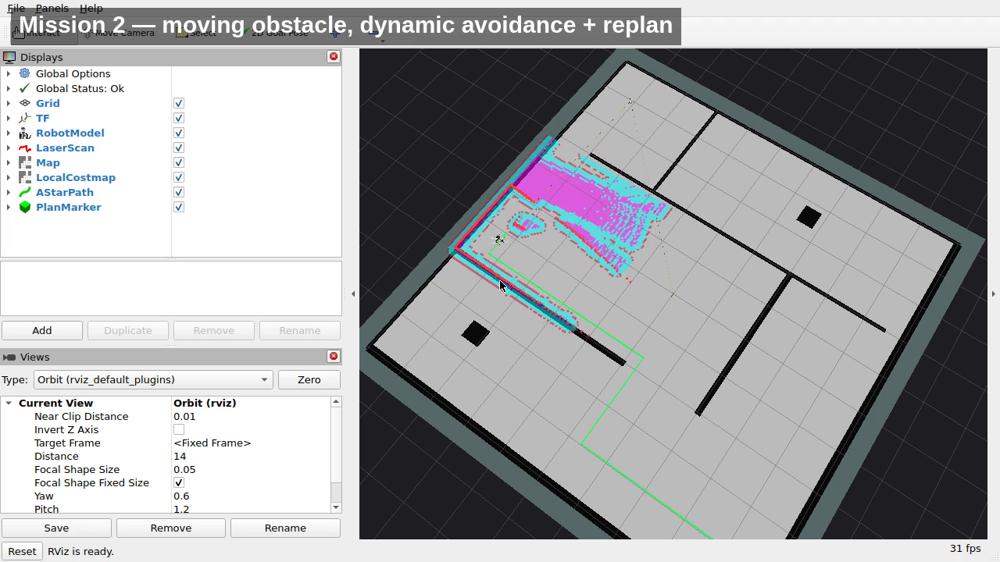

# Project 3 — AMR Navigation

Autonomous mobile robot navigation in simulation: LiDAR mapping, EKF state
estimation, a hand-written A* planner, and reflex-level dynamic obstacle
avoidance.

Stack: **ROS 2 Jazzy + Gazebo Harmonic (gz sim) + Nav2 (controller only) +
robot_localization**, all inside Docker on Arch Linux. Navigation localises
against a pre-built map (`map_server` + `nav2_amcl`); online `slam_toolbox`
mapping is still selectable with `slam:=true`.

## The three graded deliverables

| # | Deliverable | Where |
|---|---|---|
| 1 | EKF fusing IMU + wheel odometry into `odom/filtered` | `config/ekf.yaml`, `ekf_filter_node` |
| 2 | Custom A* on a discrete occupancy array, Manhattan heuristic | `src/amr_planning/amr_planning/astar.py` |
| 3 | Dynamic avoidance: local costmap → proximity error → smooth `Twist` | `src/amr_control/amr_control/avoidance_node.py` |

## Architecture

```
LiDAR ──► map_server + AMCL ──► /map + map→odom ─► a_star_node (4-way Manhattan A*)
                                                          │ FollowPath action
                                                          ▼
IMU ────┐                                           controller_server
Wheel ──┴─► ekf_node ──► TF odom→base_footprint ──► /cmd_vel_nav
                                                          │
LiDAR ──► local_costmap ──► avoidance_node (tanh) ────────┴─► /cmd_vel ──► robot
```

TF: `map → odom → base_footprint → base_link → {laser_link, imu_link, wheel_*}`

Design notes:

- **Localisation uses a pre-built map + AMCL by default.** Online SLAM over the
  sparse box maze drifts ~0.8–1.6 m against the (accurate) EKF odometry, which
  put the A* start/obstacle cells in the wrong place; localising against a known
  map removes that failure mode. `slam:=true` restores online mapping with
  `slam_toolbox` (and never runs AMCL at the same time — both would publish
  `map→odom`).
- **The map is authored in the world frame** (origin `-5.5,-5.5`, 11 m at
  0.05 m), so world `(4,4)` is map `(4,4)` and the goal below needs no offset.
  It is generated from the SDF: `python3 scripts/make_map.py`.
- **Nav2 is used for the local costmap and the controller only.** Planning is
  our own node, executing Nav2's `FollowPath` action with the A* path.
- **The avoidance node has the last word on `/cmd_vel`.** The controller
  publishes `/cmd_vel_nav`; the avoidance node scales it and republishes.
- **Dynamic obstacles are marked in the planner's overlay**, not in Nav2's
  static layer, which cannot be written at runtime.
- **1-second hold, then replan.** When the robot is pinned, the cell is
  reported after 1 s and A* re-routes.

## Build and run

```bash
# host, once
sudo pacman -S --needed xorg-xhost
xhost +local:docker

# build image + shell
./scripts/run.sh

# inside the container
colcon build --symlink-install
source install/setup.bash
ros2 launch amr_bringup demo.launch.py
```

Send a goal from RViz with **2D Goal Pose**, or:

```bash
ros2 topic pub --once /goal_pose geometry_msgs/msg/PoseStamped \
  "{header: {frame_id: map}, pose: {position: {x: 4.0, y: 4.0}, orientation: {w: 1.0}}}"
```

Useful flags:

```bash
ros2 launch amr_bringup demo.launch.py headless:=false   # Gazebo GUI (needs more RAM)
ros2 launch amr_bringup demo.launch.py dynamic:=false    # park the moving obstacle
ros2 launch amr_bringup demo.launch.py rviz:=false       # server only
ros2 launch amr_bringup demo.launch.py slam:=true        # online SLAM instead of AMCL
```

The dynamic obstacle is driven with the `gz service` CLI (`/world/maze/set_pose`)
because Harmonic exposes that only as a gz-transport service and the launch
bridges topics, not services.

## Results

Every number is measured from a recorded run, not estimated:

```bash
python3 scripts/log_run.py log/run_static.csv 140         # logs while the robot drives
PYTHONPATH=src/amr_planning python3 scripts/eval_metrics.py \
    log/run_static.csv --goal 4 4 --name "Maze, static"
```

`log_run.py` records ground truth (`/world/<world>/dynamic_pose/info`), raw wheel
odometry, EKF output, the controller command, the commanded output and the
reflex distance at 10 Hz, and saves the exact `/map` the planner saw. `eval_metrics.py`
computes the table below from that CSV.

| Scenario | Success | Time to goal (s) | Path (m) / A* optimal | Ratio | Min clearance (m) | Max decel (m/s²) | RMSE raw / EKF (m) |
|---|---|---|---|---|---|---|---|
| Static maze | yes | 92.8 | 15.95 / 16.5 | 0.97 | 0.11 | 0.9 | 0.028 / 0.027 |
| Dynamic obstacle | yes | 134.2 | 16.11 / 16.5 | 0.98 | 0.10 | 2.4 | 0.106 / 0.030 |
| Dead-end goal | yes | 106.7 | 18.5 / 19.45 | 0.95 | 0.09 | 1.5 | 0.030 / 0.034 |
| Unreachable goal | graceful stop | — | no path | — | — | — | — |

Notes, stated plainly:

- **Path ratio 0.95–0.98** is *travelled ÷ A* optimal through the inflated grid*:
  the robot drives a few percent less than the discrete optimum because the
  densified path smooths the 4-way staircase.
- **Min clearance 0.09–0.11 m** is ground-truth distance to the nearest occupied
  cell minus the 0.16 m chassis half-diagonal; the innermost sample is the start
  room doorway.
- **RMSE (static).** Raw wheel odometry is already near-exact in Gazebo (no
  slip), so the EKF does **not** lower the error there (0.028 vs 0.027). What it
  adds is a fused, 30 Hz `odom→base_footprint` that also carries IMU yaw rate.
- **RMSE (dynamic).** While blocked and re-routing around the moving box the
  wheels slip and raw odometry drifts; the EKF cuts that from 0.106 m to 0.030 m
  (down 72 %). That is the honest reason the EKF matters here — it is not a
  static-run win.
- **Dynamic scenario** produced three `BLOCKED → 1.0 s hold → mark → replan`
  events on the east corridor plus one `pinned 2.5 s → recovery` back-off. The
  box is teleported (no motor), so it is scripted to *yield* and hold position
  while the robot is within 0.75 m; the reflex still holds and re-routes, and
  nothing physically overlaps (surface distance at the hold 0.21 m > 0.17 m
  robot radius).
- **Unreachable goal** (`-3.5, 1.0`, in the sealed west room): A* returns no
  path, the node publishes an empty `/plan` and cancels the running `FollowPath`,
  and the robot halts within a second and stays — no crash, no replan loop.
- **Unreachable goal** (`-3.5, 1.0`, in the sealed west room): A* returns no
  path, the node publishes an empty `/plan` and cancels the running `FollowPath`,
  and the robot halts within a second and stays — no crash, no replan loop.

## Demo

Recorded from the headless stack (Gazebo + RViz on an isolated X display inside
the container — no desktop capture). Single mission: goal `(4, 4)` across the
maze; the moving box crosses the robot's corridor.

- Video, 4:50, 1280×720: [`docs/video/demo.mp4`](docs/video/demo.mp4)
- Screenshots: [`docs/video/`](docs/video)



The run logged **two** `BLOCKED → 1.0 s hold → mark → replan` events on the east
corridor and finished with `Reached the goal!`.

## Parameters

| Node | Key | Value | Why |
|---|---|---|---|
| `ekf_filter_node` | `frequency` | 30 Hz | smooth `odom→base_footprint` |
| | `odom0` / `imu0` | `/wheel/odom_fixed` / `/imu/data` | vx, vyaw from wheels; yaw rate from IMU |
| | `two_d_mode` | true | planar robot |
| `a_star_planner` | `occupied_threshold` | 65 | cells ≥ 65 % blocked; `-1` unknown also blocked |
| | `robot_radius` + `clearance_margin` | 0.17 + 0.05 m | 5-cell inflation @ 5 cm |
| | `heuristic_weight` | 1.0 | Manhattan, admissible → optimal |
| | `overlay_ttl` / `mark_radius` | 8 s / 0.10 m | dynamic cells expire; tight mark keeps the 1 m door open |
| `controller_server` | `FollowPath` | RPP, 0.24 m/s | tracks the A* path |
| | `xy_goal_tolerance` | 0.15 m | |
| | `use_collision_detection` | false | safety owned by the reflex node |
| `local_costmap` | `inflation_radius` | 0.20 m | 1 m doors stay passable for a 0.17 m robot |
| `avoidance_node` | `max_speed` / `safe_distance` / `min_distance` | 0.26 / 0.30 / 0.15 m | `v = v_max·tanh(k·(d−d_safe))`, hard stop at `d_min` |
| | `tanh_gain` | 3.0 | smooth deceleration |
| | `corridor_half_width` | 0.18 m | forward corridor width |
| | `obstacle_threshold` | 100 | Nav2 costs are 0..100; only lethal cells count |
| | `wait_before_mark` | 1.0 s | hold, then mark and replan |
| | `min_angular_scale` | 0.35 | throttling speed never removes the turn |
| | `stall_eps` / `cmd_ttl` | 0.03 m / 3.0 s | progress-based stall → mark + recovery, even when the controller goes quiet |

## Tests

Pure Python core, no ROS runtime needed:

```bash
PYTHONPATH=src/amr_planning:src/amr_control python3 -m pytest \
  src/amr_planning/test src/amr_control/test -q
```

Covers: A* optimality against Dijkstra on 20 random maps, 4-connectivity,
collision-free paths, inflation, nearest-free snapping, path densification
(no gap above `step`, never leaves free cells), corridor geometry, and the
200×200 performance budget.

## Layout

```
src/amr_description/   URDF/xacro, LiDAR + IMU sensors
src/amr_bringup/       launch, world, params, maps, RViz, obstacle mover
src/amr_planning/      A* core + ROS node + tests
src/amr_control/       corridor geometry + avoidance node + tests
docker/                Dockerfile + compose
scripts/               run.sh, make_map.py, log_run.py, eval_metrics.py, diag_drive.py
docs/                  report, metrics, bags
```

`scripts/make_map.py` regenerates `maps/maze.{pgm,yaml}` from the world.
`scripts/log_run.py` + `scripts/eval_metrics.py` produce the Results table.
`scripts/dump_map.py`, `scripts/dump_costmap.py` and `scripts/diag_drive.py` are
diagnostic tools (occupancy dump around the robot; costmap value scale; live
controller/pose table).

## Known limitations

- Reverse driving is not shielded by the avoidance node (the corridor only
  looks forward).
- The reflex is a speed governor, not a planner: it can only slow and steer,
  never reroute. If the robot ends up inside the inflated halo (tight doorway +
  a recovery nudge) A* has no safe plan, so the planner falls back to the raw
  occupancy (`A* escape plan through inflation`) and the reflex guards the walls
  until the robot is clear of the pocket again.
- Dynamic-obstacle holds are timing-dependent: the box yields within 0.75 m of
  the robot and can freeze at a sweep extreme, outside the 0.18 m forward
  corridor, so a given crossing may not block. When it does, the reflex holds,
  marks and replans (three events on the measured run).
- The local costmap frame is `odom`; the planner works in `map`. Both are
  handled explicitly, but the two must stay connected through the EKF.
- Gazebo GUI plus RViz plus the whole stack does not fit comfortably in 7 GB;
  the demo runs headless and visualises in RViz.
